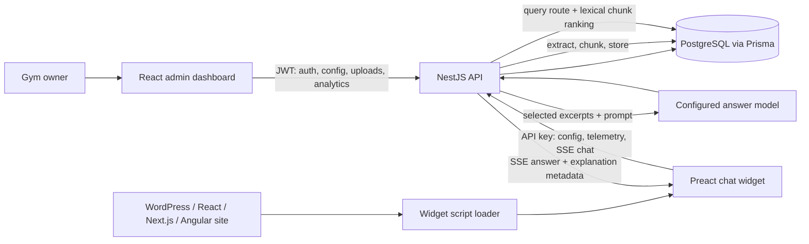

# FitBot Application Reverse Engineering Handoff

**Purpose:** Give the next design phase an architecture and evidence map for designing a search-evaluation MVP. This is an architecture-level reverse-engineering snapshot, not a line-by-line code specification or an approval to implement a particular search backend.

**Inspection date:** 2026-09-29

**Recommended reading order for the next design agent:** this document, [KNOWLEDGE_BASE_TESTING.md](KNOWLEDGE_BASE_TESTING.md), [Evaluation_upgrade.md](Evaluation_upgrade.md), [SEMANTIC_SEARCH_DESIGN_DISCUSSION.md](SEMANTIC_SEARCH_DESIGN_DISCUSSION.md), then the source links cited below. Treat code as the behavioral source of truth where plans and tests disagree.

## Executive Summary

FitBot is a multi-tenant gym-assistant application. Gym owners configure a gym profile and knowledge base in a React admin dashboard. The NestJS API stores configuration and uploaded documents in PostgreSQL through Prisma. A separately built Preact widget is embedded into WordPress or other sites and uses an API key to load public widget settings and stream chat responses. React, Next.js, and Angular packages are script-loader adapters around that widget.

The current document path is **extract text -> split into chunks -> store text -> retrieve by lexical term/phrase matching -> send selected excerpts to a configured answer model**. The MiniLM component is a semantic **query-intent router**, not semantic retrieval over document chunks. The current API loads all chunks for the requesting configuration for each chat and scores them in application memory.

The most defensible next MVP is an evaluation harness and labeled baseline using the existing handbook/document fixtures. Evaluate retrieval independently from answer generation. Consider hybrid/vector retrieval only if the measured baseline misses paraphrased or conceptually related passages; consider an answer-model change only if the correct evidence is already in the model's actual prompt and answers still fail.

## System Map

## Repository and Runtime Components

| Area | Responsibility | Search-evaluation relevance |
|---|---|---|
| `fitbot-api/` | NestJS API, Prisma schema/migrations, authentication, configuration, file ingestion, retrieval, chat providers, Stripe, tests. | Owns the actual ingestion/retrieval behavior and best home for an isolated evaluator or optional diagnostic endpoint. |
| `fitbot-admin/` | Vite/React gym-owner dashboard: authentication, settings, knowledge-base upload/list/delete, analytics, billing, widget settings. | Provides the upload workflow and existing user-facing knowledge-base scenarios. |
| `fitbot-widget/` | Vite/Preact embeddable widget; API client, streamed chat rendering, citations/explanation panel, telemetry. | Displays the retrieved-source metadata returned by the API; a primary manual evaluation surface. |
| `fitbot-wordpress-plugin/` | WordPress plugin that stores API/script URLs and an API key, then injects the widget script. | One installation adapter; must use the same explicit API and script URLs as the evaluator. |
| `packages/fitbot-react/` | Published-style React adapter that injects the widget script. | Loader only; it does not implement search or answer generation. |
| `packages/fitbot-nextjs/` | Next.js client-component wrapper/re-export for the React adapter. | Loader only. |
| `packages/fitbot-angular/` | Angular component that injects the widget script. | Loader only. |
| `demos/` | React, Next.js, Angular, WordPress-theme, and gym-site demos. React demo includes Playwright tests. | Demo tests cover integration/rendering, not retrieval quality unless assertions are added. |
| `tests/` | Mock server, integration fixture, gym documents in PDF/DOCX/TXT/ODT formats. | Candidate fixtures for a versioned evaluation corpus; confirm which formats are actually accepted by the upload API. |
| `wp-content/` | Local WordPress content/runtime assets. | Environment for manual end-to-end installation checks, not the search implementation. |
| `.github/workflows/` | CI, CI/CD, and CD workflows. | Current workflow set has overlapping coverage and should not be assumed to be a single authoritative release pipeline. |

### API Modules and HTTP Surface

The API mounts controllers under the global `/api` prefix. Routes observed in source:

| Controller | Routes | Auth/use |
|---|---|---|
| Health | `GET /api/`, `GET /api/health` | Basic service health. |
| Auth | `POST /api/auth/login`, `POST /api/auth/register`, `GET /api/auth/profile` | JWT-based admin identity. |
| Configurations | `GET /api/configurations/me`, `PUT /api/configurations/me`, `GET /api/configurations/analytics` | JWT; per-owner configuration and last-30-day interaction metrics. |
| API keys | `POST /api/api-keys` | Creates widget-facing API key. |
| Knowledge base | `POST /api/knowledge-base/upload`, `GET /api/knowledge-base`, `DELETE /api/knowledge-base/:id` | JWT; upload/list/delete documents scoped to the current user. |
| Chat logs | `GET /api/chat-logs` | Admin-facing history. |
| Stripe | `POST /api/stripe/create-checkout-session`, `POST /api/stripe/create-portal-session`, `POST /api/stripe/webhook` | Billing and webhook flow. |
| Widget | `GET /api/widget/config`, `POST /api/widget/chat`, `POST /api/widget/telemetry` | Widget API-key guard; chat is server-sent events. Chat has an additional per-route throttle. |

The widget sends `X-API-Key`; the admin uses bearer JWTs. Keep those identity paths separate in evaluator design. Do not expose admin JWT-only configuration endpoints as a shortcut for public/widget evaluation.

### Frontend Responsibilities

- **Admin:** `fitbot-admin/src/features/` separates auth and dashboard UI. Dashboard components include AI/provider settings, configuration, knowledge base, analytics, audit/chat logs, widget settings, and billing.
- **Widget:** `fitbot-widget/src/components/ChatWidget.tsx` loads public config, displays a chat, sends message history, consumes SSE chunks, and displays explanation/source metadata. It also attempts host-page theme-color telemetry.
- **Adapters:** React and Angular set `FITBOT_API_KEY` / optional `FITBOT_API_URL` and inject the widget script. The Next.js package marks the re-export as a client component. Adapter tests validate script-loading behavior, not retrieval behavior.
- **WordPress:** `gymbot.php` provides settings for API key, backend URL, and script URL, then injects the script in the page footer. Its defaults are local-development values; set deployment URLs explicitly.

## Data Model and Tenant Boundaries

PostgreSQL is accessed through Prisma. Core records relevant to search:

- `User` has an optional one-to-one `Configuration`.
- `Configuration` owns FAQ text, system instructions, selected AI provider and encrypted provider keys, widget appearance, and documents.
- `Document` stores original file name/type and extracted full text, belongs to one configuration, and owns chunks.
- `DocumentChunk` stores text and a document relation. It has an optional `tokenCount`, but current ingestion does not populate a vector or use that field as retrieval metadata.
- `ChatLog` stores user message, answer, provider/model, context character length, validation flags, and response time. It does not currently persist selected chunk IDs, per-chunk retrieval scores, route decision, route confidence, or a retrieval-model version.

There is no embedding/vector column or vector index in the inspected Prisma schema/migrations. Production database provider/plan and `pgvector` availability are not established by the checked-in Render configuration. Any vector design must first verify the deployed database and migration capabilities. Preserve configuration/tenant filtering for every retrieval query and test that no chunk can cross tenant boundaries.

## Ingestion and Current Search Behavior

### Ingestion

`KnowledgeBaseController` accepts a multipart `file`, requires a recognized extension/MIME pair, and caps the file at 5 MiB. The service supports PDF (`pdf-parse`), DOCX (`mammoth`), and TXT. It sanitizes extracted text, creates a `Document`, then uses `RecursiveCharacterTextSplitter` with `RAG_CHUNK_SIZE = 1000` and `RAG_CHUNK_OVERLAP = 200` to create stored chunks. These constants are character-splitter settings, not a verified tokenizer-token budget. No OCR path was found for scanned PDFs.

If a user configuration is absent, upload processing creates a default configuration. The normal UI flow should usually have a configuration already, but evaluation setup should account for this behavior. Existing sample assets include the Iron Oasis handbook PDF/DOCX and fake-gym PDF/TXT/ODT files; ODT is present as a fixture but is not an accepted upload type in the current API constants.

### Retrieval and Answer Generation

For each `WidgetService.processChat` call:

1. Select provider/model defaults from the configuration.
2. Call `SemanticRouterService.routeQuery(message)`. At startup it loads `Xenova/all-MiniLM-L6-v2`; it embeds the query and compares it with fixed route-anchor embeddings at a threshold of `0.80`. It chooses `standard_search` or `rag_synthesis`; if initialization fails, it returns `standard_search` with zero confidence.
3. Split configured FAQ text on blank lines; load **all** document chunks for the current `configuration.id` from Prisma, including source file names.
4. Score FAQ and document chunks in memory using query-term frequency/presence and an exact-phrase bonus. Terms are lowercased, punctuation is removed for tokenization, and a short stop-word list is applied. Chunks with zero score are dropped.
5. Select up to 6 chunks for `standard_search`; `RAG_TOP_K` is currently 4 for `rag_synthesis`.
6. Build a system prompt. `standard_search` asks for a concise, factual answer; `rag_synthesis` asks for detailed synthesis. If no chunks match, current code falls back to the first FAQ chunk when available, otherwise the literal “No FAQ information available.” This fallback can be unrelated to the query.
7. Validate the user message, then call the configured answer provider and stream output. Because retrieval occurs before input validation, blocked messages still incur routing/database/ranking work.
8. Stream an explanation object after a successful answer. It includes provider/model, context length and summary, elapsed time, validation results, deduplicated source snippets, route decision, and route confidence. Most of these diagnostic values are not written to `ChatLog`.

The router is semantic **intent classification**. The chunk ranker is lexical; it does not compute chunk embeddings, vector similarity, full-text database ranking, or hybrid fusion. The API currently retrieves every tenant chunk before ranking, so retrieval has linear read/score work as that tenant's KB grows, even though only top-K context is sent to the answer model.

### Provider Configuration

The provider registry includes OpenAI, OpenRouter, Ollama, and Hugging Face. Defaults in `fitbot-api/src/common/constants.ts` include `gpt-3.5-turbo`, `openai/gpt-3.5-turbo`, `mistral:7b`, and a Hugging Face Mistral Nemo model. These are defaults, not a recommendation for the evaluation model. `AppModule`'s Joi `AI_PROVIDER` validation currently lists only `openai`, `openrouter`, and `ollama`, while the provider registry/constants include Hugging Face; validate this inconsistency before designing a provider matrix. Keep the answer model fixed for a retrieval comparison.

## Evaluation-Relevant Existing Assets

1. **Manual questions:** [KNOWLEDGE_BASE_TESTING.md](KNOWLEDGE_BASE_TESTING.md) has five Iron Oasis handbook questions (towel policy, sauna code, low-impact hours, instructor, cancellation conditions), plus upload-format, deletion, and general RAG checks. Convert each into a case with expected source document/chunk and answer facts. These are seed smoke tests, not yet a scored retrieval benchmark.
2. **Source files:** `tests/` contains fake-gym PDF/TXT and handbook PDF/DOCX samples. Confirm their provenance, stable contents, licensing, and the parser's extracted text before committing them as evaluation fixtures. Do not silently treat ODT samples as supported inputs.
3. **API unit tests:** `RagService` tests exercise term scoring/top-K behavior. `WidgetService` tests mock the semantic router and retrieval service; those tests verify wiring/prompt choice, not model or retrieval quality. `SemanticRouterService` tests mock both the transformer pipeline and anchor JSON, so they do not benchmark real MiniLM latency or classification accuracy.
4. **Widget integration:** the Preact API client consumes the actual SSE transport and explanation event; existing widget unit/integration and Playwright tests are suitable for protocol/rendering regression checks, not as the retrieval-quality score.
5. **Observability gap:** source snippets, route decision/confidence, and timing are returned in the explanation payload, but route and retrieval scores/IDs are not persisted in chat logs. An MVP evaluator can run offline against a fixture corpus; a production-quality feedback loop would need deliberate, privacy-reviewed instrumentation.

### Minimum Evaluation MVP Scope to Consider

- Freeze a small, versioned set of documents and query cases from the existing fixtures; label expected relevant source/chunk IDs and answer facts.
- Run the unchanged lexical retriever as the baseline and report hit/recall at the current top-K, reciprocal rank, answer correctness/groundedness, abstention behavior, and p50/p95 retrieval and end-to-end latency separately.
- Add paraphrases, exact-value questions (prices, codes, dates), multi-chunk questions, ambiguous queries, and unanswerable questions. Keep ingestion failures/OCR cases in a separate extraction bucket so they are not misdiagnosed as retrieval failures.
- Compare a candidate retriever with the **same corpus, questions, prompt, and answer model**. Only after retrieval comparison, run a separate model comparison with identical retrieved context.
- Ensure tenant isolation and document deletion are tested. Record model/version, chunker parameters, top-K and environment so results are reproducible.
- Do not make `pgvector`, a separate vector database, LLM query rewriting, or an answer-model upgrade part of the initial evaluation MVP unless results or deployment constraints require them.

## Runtime, Port, Deployment, and Test Notes

### Port and URL Caveat

Do not assume `localhost:3000` is the API. The inspected files contain several values: `main.ts` calls `app.listen(process.env.PORT ?? 3002)`; `AppModule` Joi declares a default `PORT` of 3005; root development scripts wait for ports 3000 and 3001; React-test Compose publishes host 3005 to container 3000; the admin client defaults to `http://localhost:3002/api`; widget and WordPress defaults use `http://localhost:3000/api`. Effective values depend on environment/configuration and must be verified against a live health request before testing. Pass an explicit API base URL into every evaluation run and record it.

### Deployment

- `render.yaml` declares the Nest API on Render and runs `prisma migrate deploy` at start; database URLs are externally configured.
- `cd.yml` describes Render API deploy, Prisma migration, and Vercel admin/demo deploy. `ci-cd.yml` has separate API/admin/widget jobs and comments for Netlify/artifact deployment. `ci.yml` also runs API tests, admin build, and Playwright against Compose. Reconcile actual active workflows before relying on a deployment claim.
- Widget and React/Angular adapter default URLs include placeholder `cdn.fitbot.chat` hosts. Verify a real published script URL and distribution process rather than assuming the package defaults are production-ready.
- Compose files represent different environments: `docker-compose.react-test.yml` wires Postgres/API/React demo; `docker-compose.yml` is the WordPress/MySQL environment; `docker-compose.dev.yml` supplies the Postgres/pgAdmin development database. They should not be described as interchangeable.

### Tests Observed

- API command: `cd fitbot-api && npm test`; a Docker invocation used in this workspace is `docker compose -f docker-compose.react-test.yml run --rm --no-deps api npm test -- --runInBand` (run from the repository root).
- Full API suite last verified during the preceding session on 2026-09-28: 19 suites, 87 tests passed. Treat this as dated evidence, not a guarantee for the current checkout.
- Admin, widget, adapter, and Playwright suites are separate commands/packages. Read each package script and workflow before selecting test scope.
- `tests/integration/index.php` is a PHP/WordPress widget fixture; it is not by itself an automated search evaluation suite.

## Known Documentation and Repository Confidence Issues

- Root [`README.md`](README.md) was not readable as normal UTF-8 Markdown during inspection; the file reader returned a byte/hex representation. Replace or decode it before treating it as the canonical application guide.
- [`IMPLEMENTATION_PLAN.md`](IMPLEMENTATION_PLAN.md) contains unresolved merge-conflict markers near its opening. Its vector-search items are historical context, not an authoritative current approval.
- [`Evaluation_upgrade.md`](Evaluation_upgrade.md) and [`SEMANTIC_SEARCH_DESIGN_DISCUSSION.md`](SEMANTIC_SEARCH_DESIGN_DISCUSSION.md) capture recent proposed direction. They are design inputs, not proof of measured production failures.
- [`evaluation_issues.md`](evaluation_issues.md) currently contains conversational notes, not a structured, reproducible list of evaluated search failures.
- The KB manual guide previously had a `topK` value inconsistent with code and asserted router latency without a benchmark. It has since been updated to say current `rag_synthesis` top-K is 4 and to require latency measurement; verify this against current code if the constant changes.
- A prior implementation note says MiniLM route classification is under 5 ms. The router unit tests mock inference and do not establish that claim. Measure cold model load and warmed query inference separately.
- Documentation can be stale or contradictory; confirm behavior in source and a reproducible environment. No production database capabilities, real user query corpus, search-failure telemetry, or quality baseline were available in this inspection.

## Complete Markdown Inventory

The following inventory covers the 41 Markdown files returned by workspace file search before this handoff was added, plus this new file (42 total). It includes project docs, stories, workflow notes, and one generated Playwright report. Presence does not imply that a document is current or authoritative.

### Repository Root

- [APPLICATION_REVERSE_ENGINEERING.md](APPLICATION_REVERSE_ENGINEERING.md) - this handoff.
- [DEPLOYMENT_GUIDE.md](DEPLOYMENT_GUIDE.md)
- [Evaluation_upgrade.md](Evaluation_upgrade.md)
- [EXPLANATION_LAYER_FEATURES.md](EXPLANATION_LAYER_FEATURES.md)
- [EXPLANATION_LAYER_PLAN.md](EXPLANATION_LAYER_PLAN.md)
- [EXPLANATION_LAYER_PROGRESS.md](EXPLANATION_LAYER_PROGRESS.md)
- [GEMINI.md](GEMINI.md)
- [IMPLEMENTATION_PLAN.md](IMPLEMENTATION_PLAN.md)
- [INTEGRATION_TEST_SUMMARY.md](INTEGRATION_TEST_SUMMARY.md)
- [KNOWLEDGE_BASE_TESTING.md](KNOWLEDGE_BASE_TESTING.md)
- [MANUAL_TEST_PLAN.md](MANUAL_TEST_PLAN.md)
- [README.md](README.md)
- [SECURITY_AUDIT_REPORT.md](SECURITY_AUDIT_REPORT.md)
- [SEMANTIC_SEARCH_COMPARISON.md](SEMANTIC_SEARCH_COMPARISON.md)
- [SEMANTIC_SEARCH_DESIGN_DISCUSSION.md](SEMANTIC_SEARCH_DESIGN_DISCUSSION.md)
- [STRIPE_TEST_PLAN.md](STRIPE_TEST_PLAN.md)
- [WIDGET_IMPLEMENTATION_PLAN.md](WIDGET_IMPLEMENTATION_PLAN.md)
- [WIDGET_INSTALLATION_GUIDE.md](WIDGET_INSTALLATION_GUIDE.md)
- [WORDPRESS_DEPLOYMENT.md](WORDPRESS_DEPLOYMENT.md)
- [evaluation_issues.md](evaluation_issues.md)

### Agent Workflow and AI Stories

- [.agent/workflows/release-to-production.md](.agent/workflows/release-to-production.md)
- [ai/stories/1.1.story.md](ai/stories/1.1.story.md)
- [ai/stories/1.2.story.md](ai/stories/1.2.story.md)
- [ai/stories/1.3.story.md](ai/stories/1.3.story.md)
- [ai/stories/2.1.story.md](ai/stories/2.1.story.md)
- [ai/stories/2.2.story.md](ai/stories/2.2.story.md)
- [ai/stories/2.3.story.md](ai/stories/2.3.story.md)
- [ai/stories/3.1.story.md](ai/stories/3.1.story.md)
- [ai/stories/4.1.story.md](ai/stories/4.1.story.md)
- [ai/stories/4.2.story.md](ai/stories/4.2.story.md)
- [ai/stories/5.1.story.md](ai/stories/5.1.story.md)
- [ai/stories/6.1.story.md](ai/stories/6.1.story.md)
- [ai/stories/7.1.story.md](ai/stories/7.1.story.md)
- [ai/stories/7.2.story.md](ai/stories/7.2.story.md)

### Project and Package Directories

- [fitbot-admin/README.md](fitbot-admin/README.md)
- [fitbot-api/README.md](fitbot-api/README.md)
- [packages/fitbot-angular/projects/fitbot-angular/README.md](packages/fitbot-angular/projects/fitbot-angular/README.md)
- [packages/fitbot-react/IMPLEMENTATION_PLAN.md](packages/fitbot-react/IMPLEMENTATION_PLAN.md)
- [packages/fitbot-react/README.md](packages/fitbot-react/README.md)

### Demos and Generated Reports

- [demos/fitbot-angular-demo/README.md](demos/fitbot-angular-demo/README.md)
- [demos/fitbot-nextjs-demo/README.md](demos/fitbot-nextjs-demo/README.md)
- [demos/fitbot-react-demo/playwright-report/data/738852b698e30c3f5f2ae2d349a704f2fcc9e435.md](demos/fitbot-react-demo/playwright-report/data/738852b698e30c3f5f2ae2d349a704f2fcc9e435.md) - generated report artifact; do not use as a design decision source.

## Questions for the Next Design Phase

1. What are representative user questions, document sizes, number of chunks per gym, and actual examples where the current answer failed?
2. Is the failure at extraction, retrieval, prompt/context assembly, or answer generation? Capture expected source passage and inspect the exact prompt context before attributing failures to an LLM.
3. What quality gates matter most: exact fact retrieval, paraphrase recall, abstention/no-answer correctness, citation/source correctness, or latency/cost?
4. What should the evaluation report and where should it run: offline Jest/Node harness, CI job, or an authenticated internal diagnostic endpoint? Prefer offline fixtures for the first MVP.
5. Which answer model and prompt are the fixed baseline? How will temperature/provider variability be controlled?
6. What is the deployment target's supported PostgreSQL version, provider/plan, and `pgvector` extension capability? Do not assume local Compose proves production extension support.
7. How should vector model/version changes trigger re-embedding and backfill? What is the safe fallback if local model initialization or embedding generation fails?
8. What privacy/retention rules govern uploaded document text, extracted chunks, query text, answer prompts, source snippets, and evaluation fixtures?
9. What is the agreed no-match policy? Current FAQ-first fallback can inject irrelevant context; define behavior and test it before comparing retrieval strategies.
10. Which of the 42 Markdown documents is the design authority after the merge-conflicted implementation plan and old stories are reconciled?